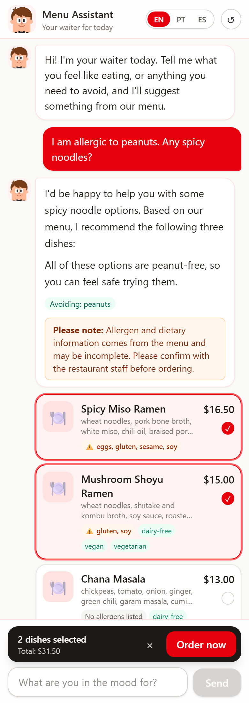
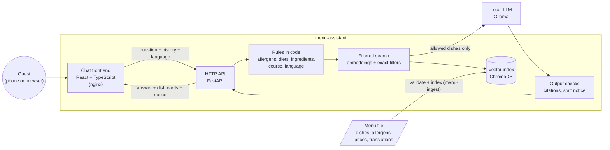
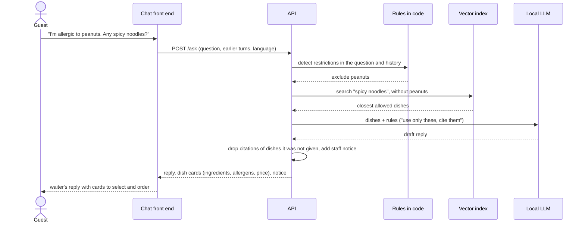

# menu-assistant

**English** | [Português (Brasil)](README.pt-BR.md)

[](https://github.com/gabrielvscodigos/menu-assistant/actions/workflows/ci.yml)

An AI waiter that helps guests choose what to eat from a restaurant menu. Ask *"I'm
allergic to peanuts, any spicy noodles?"* and it suggests dishes from that menu only,
filters out what you must avoid, shows each dish with its ingredients, allergens, and
price, and lets you order. It speaks English, Portuguese, and Spanish, and runs entirely
on your own machine.

<p align="center">
  
</p>

## 1. The Problem

Choosing from a menu is harder than it looks, and the cost lands on both guests and the
restaurant:

- **Menus describe dishes, not people.** A guest who wants "something like spicy ramen" or
  "a light, vegan starter" has to read the whole menu and guess. Unfamiliar dish names
  (*birria*, *dan dan*, *gyoza*) make it worse, and so does reading in a second language.
- **Allergies and diets depend on asking staff.** Guests with allergies, intolerances, or
  diets must ask about every dish. Staff are busy, information is passed on from memory,
  and a wrong answer can make someone sick.
- **Staff time goes to repeated questions.** "Does this have nuts?", "What is vegan?",
  "What do you recommend?" are asked at every table. That time is not spent serving,
  orders take longer, and tables turn over more slowly.
- **Generic chatbots are not safe here.** A general-purpose AI will happily invent a dish
  the restaurant does not serve, guess an allergen, or quote a price that does not exist.
  For food, a confident wrong answer is worse than no answer.

The result: slower service, hesitant guests who order less or the same thing as always,
avoidable mistakes with allergies, and a menu that does not help guests discover it.

## 2. The Proposed Solution

A virtual waiter that knows **this restaurant's menu and nothing else**, available on the
guest's phone:

- **Talk, don't search.** Guests describe what they feel like, in their own words and
  language, and follow up naturally ("and a dessert?", "other options").
- **Grounded answers only.** Every suggestion comes from the restaurant's menu data and is
  cited; if something is not on the menu, the waiter says so instead of inventing it.
- **Safety enforced in code, not left to the AI.** Allergies, diets, and disliked
  ingredients ("no peanuts", "sou vegano", "sin cebolla") are detected and filtered with
  deterministic rules before the AI sees any dish, and they stay applied for the whole
  conversation. Every answer about allergens reminds the guest to confirm with staff.
- **Clear dish cards and ordering.** Suggestions appear as cards with ingredients,
  allergen warnings, diet tags, and price; guests select dishes and order from the chat.
- **Local language and prices.** English, Portuguese (with dish names and prices in R$),
  and Spanish.
- **Private and cheap to run.** The language model runs locally through Ollama, on CPU:
  no guest data leaves the machine and there is no per-question API cost.

For the restaurant this means fewer repeated questions, faster and more confident orders,
fewer allergy mistakes, and a menu guests actually explore.

## 3. How It Works

The restaurant's menu is a validated JSON file. It is indexed once; then every question
goes through code-enforced rules, a filtered search, the local language model, and
checks on the model's output before anything reaches the guest.



What happens when a guest asks a question:



**Steps to run it for a restaurant**

1. **Describe the menu** in `data/menu.json`: each dish with ingredients, allergens (the
   14 EU major allergens), dietary flags, price, and optional translations. Validation
   rejects contradictions such as a "vegan" dish that lists eggs.
2. **Start the stack** with `docker compose up --build`: the API, the chat front end,
   Ollama, and the model download. The menu is indexed on start.
3. **Share the chat**, for example through a QR code on the table pointing to the front
   end.

**Tools and integrations:** Python 3.12, FastAPI, ChromaDB, a multilingual
sentence-transformers model, Ollama (`llama3.2` by default), React + TypeScript, Docker
Compose. The language model sits behind a small `LLMClient` interface, so a hosted
provider can be added without touching the rest; orders currently stay in the chat and
are the natural point to connect a restaurant's ordering system.

**Why it is reliable:** filters run in code and are double-checked against the dish data;
retrieval is measured on 49 labeled questions (recall@5 0.990, zero filter violations);
answers are checked with deterministic rules; the code has 360+ backend tests and a
typed, tested front end. Details: [docs/architecture.md](docs/architecture.md),
[docs/evaluation.md](docs/evaluation.md), and the design decisions in
[docs/decisions.md](docs/decisions.md).

## Quick start with Docker

Only [Docker](https://docs.docker.com/get-docker/) is needed:

```bash
docker compose up --build
```

Then open the chat at <http://localhost:8080> (the API docs are at
<http://localhost:8000/docs>). The first start downloads `llama3.2` (~2 GB) and the
embedding model (~1.1 GB) into named volumes, so it takes a few minutes; later starts
reuse them. Use another Ollama model with `MENU_ASSISTANT_LLM_MODEL=qwen2.5:7b docker
compose up`. Everything runs on CPU; `docker compose down -v` removes the volumes.

## Run locally

Prerequisites: [uv] (it installs Python 3.12 if needed), [Ollama](https://ollama.com),
and for the front end Node.js 22.13+ with pnpm 10.

```bash
git clone https://github.com/gabrielvscodigos/menu-assistant.git
cd menu-assistant
uv sync
ollama pull llama3.2
uv run menu-ingest data/menu.json      # validate and index the menu
uv run uvicorn menu_assistant.api.main:app --reload
```

In a second terminal, the chat front end:

```bash
cd frontend
pnpm install
pnpm dev        # http://localhost:5173
```

The first ingestion downloads the embedding model (~1.1 GB). Re-running it is idempotent:
dishes are upserted by id and dishes no longer on the menu are removed. If the embedding
model or the stored data format changes, ingestion rebuilds the index, and the API refuses
an outdated index with a clear message.

## The chat

- Ask in English, Portuguese, or Spanish; the EN / PT / ES buttons set the language of the
  interface, the replies, the dish names, and the prices (R$ in Portuguese).
- Suggested dishes appear as cards below the reply: ingredients, allergen warnings, diet
  tags, and price. "Other options" asks for different dishes.
- Select dishes across answers and press "Order now": the order (with total) is added to
  the chat with an allergy reminder. Orders stay in the browser for now.
- Restrictions stated once keep applying for the whole conversation.

Details in [frontend/README.md](frontend/README.md).

## Command line

With the menu indexed and Ollama running:

```bash
uv run menu-ask "I like spicy ramen, what else here would I enjoy?"
uv run menu-ask "I'm allergic to peanuts. Any spicy noodles?"
uv run menu-ask "something light" --exclude soy --diet vegan
uv run menu-ask "a hearty curry" --without onion --without garlic
uv run menu-ask "Quero uma sobremesa vegana"   # Portuguese: dessert course, prices in R$
uv run menu-ask --chat                          # follow-up questions; empty line to exit
```

Example output:

```text
You might enjoy the Spicy Miso Ramen [spicy-miso-ramen] and the Dan Dan Noodles
[dan-dan-noodles]. Both have a spicy kick: the ramen has a rich, savory broth, while
the noodles come in a numbing, spicy sesame sauce.

Sources:
  - Spicy Miso Ramen [spicy-miso-ramen]
  - Dan Dan Noodles [dan-dan-noodles]
Restrictions applied: none
```

How an answer is produced:

1. **Restrictions are decided in code.** `--exclude` / `--diet` / `--without` options are
   combined with restrictions detected in the question and earlier turns ("allergic to
   peanuts", "sou vegano", "sin gluten", "no onions"), using deterministic patterns in
   English, Portuguese, and Spanish. A requested course ("a vegan dessert") is detected
   the same way, or set with `--course`.
2. **Retrieval applies them as exact filters**, so excluded dishes never reach the LLM.
   If nothing passes, a fixed "no match" reply is returned without calling the LLM.
3. **The LLM writes the reply** from the retrieved dishes only (in the guest's language,
   with translated names and local prices), citing them as `[dish-id]`.
4. **The output is checked in code.** Citations of dishes that were not retrieved are
   removed, dish names are mapped to ids, and list items that do not name a retrieved dish
   are dropped. Whenever allergens or diets are involved, the staff-confirmation notice
   is added by code, in the guest's language.

Known limitation of the default 3B model: its wording can be imprecise (for example,
describing an ingredient wrongly). The dishes it is allowed to suggest are always safe,
because filtering never depends on the LLM; larger models (`qwen2.5:7b`) follow the rules
better.

## HTTP API

Interactive docs (Swagger UI) are at <http://127.0.0.1:8000/docs>.

| Method | Path      | Description                                                                 |
| ------ | --------- | --------------------------------------------------------------------------- |
| GET    | `/health` | `ok`, or `degraded` with a fix-it message if the index or the LLM is not ready |
| POST   | `/ask`    | Grounded suggestions for a question                                         |

```bash
curl -X POST http://127.0.0.1:8000/ask \
  -H "Content-Type: application/json" \
  -d '{"question": "Any spicy noodles?", "exclude_allergens": ["peanuts"]}'
```

```json
{
  "answer": "... Spicy Miso Ramen [spicy-miso-ramen] ...",
  "sources": [{"id": "spicy-miso-ramen", "name": "Spicy Miso Ramen", "course": "main",
               "description": "Rich pork broth blended with white miso ...",
               "ingredients": ["wheat noodles", "pork bone broth", "..."],
               "price": {"amount": "16.50", "currency": "USD"},
               "allergens": ["eggs", "gluten", "sesame", "soy"], "dietary_flags": [],
               "score": 0.91}],
  "candidates": ["... every dish the LLM was given ..."],
  "applied_restrictions": {"exclude_allergens": ["peanuts"], "require_flags": [],
                           "exclude_ingredients": [], "course": null},
  "language": "en",
  "notice": "Allergen and dietary information comes from the menu and may be incomplete. ..."
}
```

Optional request fields:

| Field                 | Meaning                                                                  |
| --------------------- | ------------------------------------------------------------------------ |
| `exclude_allergens`   | Allergens to avoid (`peanuts`, `gluten`, ...)                             |
| `require_flags`       | Required diets (`vegan`, `gluten_free`, ...)                              |
| `exclude_ingredients` | Ingredients to avoid (`onion`; common Portuguese/Spanish words are mapped) |
| `course`              | `starter`, `main`, `side`, or `dessert`; detected from the question if omitted |
| `language`            | `en`, `pt`, or `es`: language of the reply, notice, dish names, and prices |
| `exclude_dishes`      | Dish ids not to suggest, e.g. to ask for "other options"                  |
| `history`             | Earlier turns, oldest first (up to 20); restrictions in them keep applying |

The server keeps no state: send the earlier turns in `history` for a follow-up question.
Invalid values are rejected with `422`; if Ollama is unreachable, `/ask` returns `503`
with the reason.

## Configuration

Settings are read from environment variables or a `.env` file. Copy
[`.env.example`](.env.example) to `.env` to override the defaults:

| Variable                                   | Default                          |
| ------------------------------------------ | -------------------------------- |
| `MENU_ASSISTANT_CHROMA_PATH`               | `.chroma`                        |
| `MENU_ASSISTANT_COLLECTION_NAME`           | `menu`                           |
| `MENU_ASSISTANT_EMBEDDING_MODEL`           | `intfloat/multilingual-e5-base`  |
| `MENU_ASSISTANT_EMBEDDING_QUERY_PREFIX`    | `query: `                        |
| `MENU_ASSISTANT_EMBEDDING_DOCUMENT_PREFIX` | `passage: `                      |
| `MENU_ASSISTANT_TAG_BOOST`                 | `0.05`                           |
| `MENU_ASSISTANT_LLM_PROVIDER`              | `ollama`                         |
| `MENU_ASSISTANT_LLM_MODEL`                 | `llama3.2`                       |
| `MENU_ASSISTANT_LLM_TEMPERATURE`           | `0.2`                            |
| `MENU_ASSISTANT_LLM_TIMEOUT_SECONDS`       | `120`                            |
| `MENU_ASSISTANT_OLLAMA_BASE_URL`           | `http://localhost:11434`         |

The retrieval defaults were chosen by evaluation; see [docs/evaluation.md](docs/evaluation.md).
Any Ollama model works through `MENU_ASSISTANT_LLM_MODEL`.

## Evaluation

Retrieval is measured on 49 hand-labeled queries (taste preferences; allergen, diet, and
ingredient filters; Brazilian Portuguese and Spanish questions) with recall@5, MRR, and a
filter-violation count that must stay at zero.

| Configuration                                   | recall@5  | MRR       | violations |
| ----------------------------------------------- | --------: | --------: | ---------: |
| Baseline (MiniLM-L12, pure vector search)       |     0.750 |     0.783 |          0 |
| multilingual-e5-base + tag boost (34 cases)     |     0.956 |     0.934 |          0 |
| + Portuguese tag aliases (44 cases)             |     0.989 |     0.966 |          0 |
| **Current** (+ 5 ingredient-dislike cases, 49)  | **0.990** | **0.969** |          0 |

Generated answers are checked separately on 29 questions (with Ollama running) using
deterministic rules, not an LLM judge. The results below were measured on the earlier
28-question set, before prices were added to the menu:

| Check (llama3.2)                                       | Result |
| ------------------------------------------------------ | -----: |
| Cases passing every check                              |    93% |
| Replies naming a dish retrieval excluded               |      0 |
| Staff notice present exactly when expected             |   100% |
| Off-menu requests acknowledged ("not on the menu")     |    83% |
| Raw replies citing an id the model was not given       | 0–9%\* |
| Replies with a listed dish the model was not given     | 0–9%\* |

\* across runs; removed in code before the guest sees them.

Method, the full experiment grid, remaining misses, and caveats are in
[docs/evaluation.md](docs/evaluation.md).

## Menu data

Menus are JSON files validated against the models in
[`src/menu_assistant/models.py`](src/menu_assistant/models.py). Each dish has:

| Field           | Description                                                        |
| --------------- | ------------------------------------------------------------------ |
| `id`            | Stable slug (`spicy-miso-ramen`), used for indexing and citations  |
| `name`          | Display name                                                       |
| `course`        | `starter`, `main`, `side`, or `dessert`                            |
| `description`   | Short description of the dish                                      |
| `ingredients`   | Non-empty list of ingredients                                      |
| `preparation`   | How the dish is made                                               |
| `price`         | `{"amount": "16.50", "currency": "USD"}`: exact decimal, one currency per menu |
| `tags`          | Free-form lowercase tags (`spicy`, `japanese`, `noodles`, ...)     |
| `dietary_flags` | `vegan`, `vegetarian`, `gluten_free`, `dairy_free`, `halal`        |
| `allergens`     | The 14 EU major allergens (`gluten`, `peanuts`, `sesame`, ...)     |
| `translations`  | Optional, per language (`pt`): name, description, ingredients, preparation, and a local price (e.g. BRL) |

Translations change only what the guest reads. Allergens, dietary flags, tags, and the
English ingredient list stay on the dish and drive every filter, so a translation can
never weaken one. Spanish has no translation yet and falls back to English (USD).

Validation rejects unknown fields, unknown allergens or flags, duplicate ids, mixed
currencies, and contradictions such as a `vegan` dish listing `eggs` or a `gluten_free`
dish listing `gluten`. [`data/menu.json`](data/menu.json) is a **fictional** sample menu
with 25 dishes across several cuisines, fully translated to Portuguese.

## Development

| Task                       | Command                                                    |
| -------------------------- | ---------------------------------------------------------- |
| Run backend tests          | `uv run pytest` (`--cov`: CI fails below 90%)              |
| Lint / format              | `uv run ruff check .` / `uv run ruff format .`             |
| Type check                 | `uv run mypy src tests`                                    |
| Evaluate retrieval         | `uv run menu-eval`                                         |
| Evaluate answers           | `uv run menu-eval-answers` (needs Ollama)                  |
| Export the API schema      | `uv run python -m menu_assistant.api.openapi`              |
| Front end checks           | `pnpm lint`, `pnpm typecheck`, `pnpm test` (in `frontend/`) |

CI runs both the Python checks and the front-end checks, including a check that the
front end's TypeScript types match the API schema.

## Project structure

```
src/menu_assistant/
  models.py   menu domain models (Dish, Menu, prices, translations, allergens)
  config.py   settings from environment variables / .env
  console.py  UTF-8 output for the command-line tools
  api/        FastAPI app, routes, and OpenAPI schema export
  ingest/     menu loading, validation, indexing
  retrieval/  embeddings, vector store, filters, ingredient matching, ranking
  llm/        LLMClient interface and provider implementations
  rag/        restriction, course, and language detection; prompts; grounded answers
  eval/       evaluation datasets, metrics, and reports
data/         sample (fictional) menu and evaluation datasets
tests/        mirrors src/ structure
docs/         architecture, evaluation, decisions, improvement log, images
frontend/     chat front end with the waiter mascot (React + TypeScript)
```

Further reading: [docs/architecture.md](docs/architecture.md) (how the pieces fit),
[docs/decisions.md](docs/decisions.md) (design decisions and trade-offs), and
[docs/improvements.md](docs/improvements.md) (the improvement log).

## License

See [LICENSE](LICENSE).

[uv]: https://docs.astral.sh/uv/
