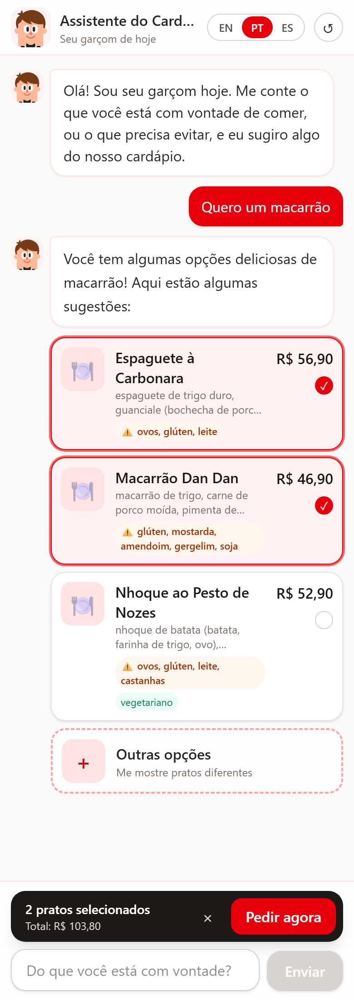
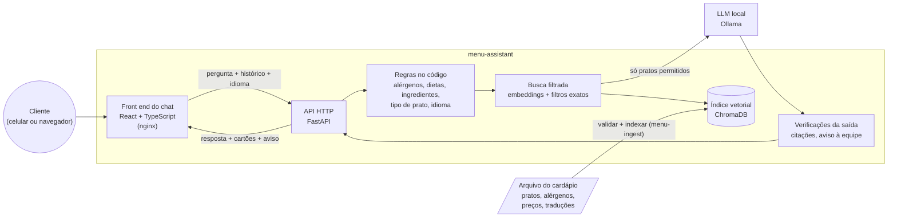
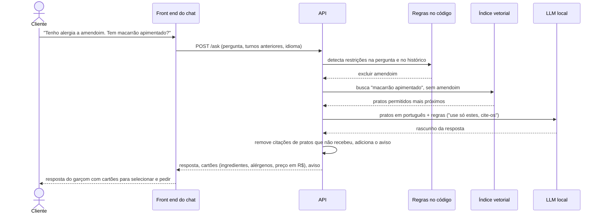

# menu-assistant

[English](README.md) | **Português (Brasil)**

[](https://github.com/gabrielvscodigos/menu-assistant/actions/workflows/ci.yml)

Um garçom com IA que ajuda o cliente a escolher o que comer no cardápio de um
restaurante. Pergunte *"Tenho alergia a amendoim, tem algum macarrão apimentado?"* e ele
sugere pratos só desse cardápio, tira o que você precisa evitar, mostra cada prato com
ingredientes, alérgenos e preço, e deixa você fazer o pedido. Ele fala português, inglês e
espanhol, e roda inteiramente na sua própria máquina.

<p align="center">
  
</p>

## 1. O Problema

Escolher no cardápio é mais difícil do que parece, e o custo cai sobre o cliente e sobre o
restaurante:

- **Cardápios descrevem pratos, não pessoas.** Quem quer "algo parecido com um lámen
  apimentado" ou "uma entrada leve e vegana" precisa ler o cardápio inteiro e adivinhar.
  Nomes desconhecidos (*birria*, *dan dan*, *guioza*) pioram, e ler em outro idioma também.
- **Alergias e dietas dependem de perguntar à equipe.** Quem tem alergia, intolerância ou
  dieta precisa perguntar sobre cada prato. A equipe está ocupada, a informação passa de
  boca em boca, e uma resposta errada pode fazer alguém passar mal.
- **O tempo da equipe vai para perguntas repetidas.** "Isso tem castanha?", "O que é
  vegano?", "O que você recomenda?" se repetem em toda mesa. Esse tempo não vai para o
  atendimento, os pedidos demoram mais e as mesas giram mais devagar.
- **Chatbots genéricos não são seguros aqui.** Uma IA de uso geral inventa sem problema um
  prato que o restaurante não serve, chuta um alérgeno ou cita um preço que não existe. Com
  comida, uma resposta errada e confiante é pior do que nenhuma resposta.

O resultado: atendimento mais lento, clientes inseguros que pedem menos ou sempre a mesma
coisa, erros evitáveis com alergias e um cardápio que não ajuda o cliente a descobri-lo.

## 2. A Solução Proposta

Um garçom virtual que conhece **o cardápio deste restaurante e nada mais**, disponível no
celular do cliente:

- **Conversar em vez de procurar.** O cliente descreve o que está com vontade, com as
  próprias palavras e no próprio idioma, e continua a conversa naturalmente ("e uma
  sobremesa?", "outras opções").
- **Só respostas fundamentadas.** Toda sugestão vem dos dados do cardápio e é citada; se
  algo não está no cardápio, o garçom diz isso em vez de inventar.
- **Segurança garantida no código, não deixada para a IA.** Alergias, dietas e
  ingredientes indesejados ("sem amendoim", "sou vegano", "sin cebolla") são detectados e
  filtrados com regras determinísticas antes de a IA ver qualquer prato, e continuam
  valendo durante toda a conversa. Toda resposta sobre alérgenos lembra o cliente de
  confirmar com a equipe.
- **Cartões claros e pedido.** As sugestões aparecem como cartões com ingredientes, alertas
  de alérgenos, tags de dieta e preço; o cliente seleciona os pratos e faz o pedido pelo
  chat.
- **Idioma e preços locais.** Português (com nomes dos pratos e preços em R$), inglês e
  espanhol.
- **Privado e barato de rodar.** O modelo de linguagem roda localmente pelo Ollama, na CPU:
  nenhum dado do cliente sai da máquina e não há custo de API por pergunta.

Para o restaurante isso significa menos perguntas repetidas, pedidos mais rápidos e
seguros, menos erros com alergias e um cardápio que os clientes realmente exploram.

## 3. Como Funciona

O cardápio do restaurante é um arquivo JSON validado. Ele é indexado uma vez; depois, toda
pergunta passa por regras garantidas no código, por uma busca filtrada, pelo modelo de
linguagem local e por verificações na saída do modelo antes de chegar ao cliente.



O que acontece quando o cliente faz uma pergunta:



**Passos para usar em um restaurante**

1. **Descreva o cardápio** em `data/menu.json`: cada prato com ingredientes, alérgenos (os
   14 principais alérgenos da UE), restrições alimentares, preço e traduções opcionais. A
   validação rejeita contradições, como um prato "vegano" que lista ovos.
2. **Suba tudo** com `docker compose up --build`: a API, o front end do chat, o Ollama e o
   download do modelo. O cardápio é indexado na inicialização.
3. **Compartilhe o chat**, por exemplo com um QR code na mesa apontando para o front end.

**Ferramentas e integrações:** Python 3.12, FastAPI, ChromaDB, um modelo multilíngue do
sentence-transformers, Ollama (`llama3.2` por padrão), React + TypeScript, Docker Compose.
O modelo de linguagem fica atrás de uma interface pequena, `LLMClient`, então um provedor
hospedado pode ser adicionado sem mexer no resto; por enquanto os pedidos ficam no chat e
são o ponto natural para conectar o sistema de pedidos do restaurante.

**Por que é confiável:** os filtros rodam no código e são conferidos de novo contra os
dados do prato; a busca é medida em 49 perguntas rotuladas (recall@5 0,990, zero violações
de filtro); as respostas são verificadas com regras determinísticas; o código tem mais de
360 testes no backend e um front end tipado e testado. Detalhes (em inglês):
[docs/architecture.md](docs/architecture.md), [docs/evaluation.md](docs/evaluation.md) e
as decisões de design em [docs/decisions.md](docs/decisions.md).

## Início rápido com Docker

Só é preciso o [Docker](https://docs.docker.com/get-docker/):

```bash
docker compose up --build
```

Depois abra o chat em <http://localhost:8080> (a documentação da API fica em
<http://localhost:8000/docs>). A primeira inicialização baixa o `llama3.2` (~2 GB) e o
modelo de embeddings (~1,1 GB) para volumes nomeados, então leva alguns minutos; as
próximas reaproveitam tudo. Para usar outro modelo do Ollama:
`MENU_ASSISTANT_LLM_MODEL=qwen2.5:7b docker compose up`. Tudo roda na CPU;
`docker compose down -v` remove os volumes.

## Rodar localmente

Pré-requisitos: [uv] (ele instala o Python 3.12 se precisar), [Ollama](https://ollama.com)
e, para o front end, Node.js 22.13+ com pnpm 10.

```bash
git clone https://github.com/gabrielvscodigos/menu-assistant.git
cd menu-assistant
uv sync
ollama pull llama3.2
uv run menu-ingest data/menu.json      # valida e indexa o cardápio
uv run uvicorn menu_assistant.api.main:app --reload
```

Em um segundo terminal, o front end do chat:

```bash
cd frontend
pnpm install
pnpm dev        # http://localhost:5173
```

A primeira indexação baixa o modelo de embeddings (~1,1 GB). Rodar de novo é idempotente:
os pratos são atualizados pelo id e pratos que saíram do cardápio são removidos. Se o
modelo de embeddings ou o formato dos dados mudar, a indexação reconstrói o índice, e a API
recusa um índice desatualizado com uma mensagem clara.

## O chat

- Pergunte em português, inglês ou espanhol; os botões EN / PT / ES definem o idioma da
  interface, das respostas, dos nomes dos pratos e dos preços (R$ em português).
- Os pratos sugeridos aparecem como cartões abaixo da resposta: ingredientes, alertas de
  alérgenos, tags de dieta e preço. "Outras opções" pede pratos diferentes.
- Selecione pratos de várias respostas e toque em "Pedir agora": o pedido (com o total)
  entra no chat com um lembrete sobre alergias. Por enquanto os pedidos ficam no navegador.
- Restrições ditas uma vez continuam valendo durante toda a conversa.

Detalhes (em inglês) em [frontend/README.md](frontend/README.md).

## Linha de comando

Com o cardápio indexado e o Ollama rodando:

```bash
uv run menu-ask "Quero uma sobremesa vegana"   # tipo de prato: sobremesa, preços em R$
uv run menu-ask "Tenho alergia a amendoim. Tem algum macarrão apimentado?"
uv run menu-ask "algo leve" --exclude soy --diet vegan
uv run menu-ask "um curry encorpado" --without onion --without garlic
uv run menu-ask "I like spicy ramen, what else here would I enjoy?"
uv run menu-ask --chat                          # perguntas de continuação; linha vazia sai
```

Como uma resposta é produzida:

1. **As restrições são decididas no código.** As opções `--exclude` / `--diet` /
   `--without` são combinadas com restrições detectadas na pergunta e nos turnos
   anteriores ("sou alérgico a amendoim", "sou vegano", "sem glúten", "sem cebola"), usando
   padrões determinísticos em português, inglês e espanhol. Um tipo de prato pedido ("uma
   sobremesa vegana") é detectado da mesma forma, ou definido com `--course`.
2. **A busca aplica as restrições como filtros exatos**, então pratos excluídos nunca
   chegam ao LLM. Se nada passar, uma resposta fixa de "nenhum prato encontrado" é
   devolvida sem chamar o LLM.
3. **O LLM escreve a resposta** só com os pratos recuperados (no idioma do cliente, com
   nomes traduzidos e preços locais), citando-os como `[id-do-prato]`.
4. **A saída é verificada no código.** Citações de pratos que não foram recuperados são
   removidas, nomes de pratos viram ids, e itens de lista que não nomeiam um prato
   recuperado são descartados. Sempre que há alérgenos ou dietas envolvidos, o aviso para
   confirmar com a equipe é adicionado pelo código, no idioma do cliente.

Limitação conhecida do modelo padrão de 3B: o texto pode ser impreciso (por exemplo,
descrever um ingrediente de forma errada). Os pratos que ele pode sugerir são sempre
seguros, porque a filtragem nunca depende do LLM; modelos maiores (`qwen2.5:7b`) seguem
melhor as regras.

## API HTTP

A documentação interativa (Swagger UI) fica em <http://127.0.0.1:8000/docs>.

| Método | Caminho   | Descrição                                                                        |
| ------ | --------- | -------------------------------------------------------------------------------- |
| GET    | `/health` | `ok`, ou `degraded` com uma mensagem de como corrigir se o índice ou o LLM não estiver pronto |
| POST   | `/ask`    | Sugestões fundamentadas para uma pergunta                                        |

No PowerShell, use `curl.exe` e escape as aspas do JSON (`'{\"question\": \"...\"}'`), ou
use a página `/docs`.

```bash
curl -X POST http://127.0.0.1:8000/ask \
  -H "Content-Type: application/json" \
  -d '{"question": "Tem macarrão apimentado?", "exclude_allergens": ["peanuts"], "language": "pt"}'
```

```json
{
  "answer": "... Lámen de Missô Apimentado [spicy-miso-ramen] ...",
  "sources": [{"id": "spicy-miso-ramen", "name": "Lámen de Missô Apimentado", "course": "main",
               "description": "Caldo encorpado de porco com missô branco ...",
               "ingredients": ["macarrão de trigo", "caldo de osso de porco", "..."],
               "price": {"amount": "54.90", "currency": "BRL"},
               "allergens": ["eggs", "gluten", "sesame", "soy"], "dietary_flags": [],
               "score": 0.91}],
  "candidates": ["... todos os pratos que o LLM recebeu ..."],
  "applied_restrictions": {"exclude_allergens": ["peanuts"], "require_flags": [],
                           "exclude_ingredients": [], "course": null},
  "language": "pt",
  "notice": "As informações sobre alérgenos e restrições alimentares vêm do cardápio e podem estar incompletas. ..."
}
```

Campos opcionais da requisição:

| Campo                 | Significado                                                              |
| --------------------- | ------------------------------------------------------------------------ |
| `exclude_allergens`   | Alérgenos a evitar (`peanuts`, `gluten`, ...)                             |
| `require_flags`       | Dietas exigidas (`vegan`, `gluten_free`, ...)                             |
| `exclude_ingredients` | Ingredientes a evitar (`onion`; palavras comuns em português/espanhol são mapeadas) |
| `course`              | `starter`, `main`, `side` ou `dessert`; detectado na pergunta se omitido  |
| `language`            | `en`, `pt` ou `es`: idioma da resposta, do aviso, dos nomes e dos preços  |
| `exclude_dishes`      | Ids de pratos a não sugerir, por exemplo para pedir "outras opções"       |
| `history`             | Turnos anteriores, do mais antigo ao mais novo (até 20); as restrições deles continuam valendo |

O servidor não guarda estado: envie os turnos anteriores em `history` para uma pergunta de
continuação. Valores inválidos são rejeitados com `422`; se o Ollama estiver inacessível,
`/ask` retorna `503` com o motivo.

## Configuração

As configurações vêm de variáveis de ambiente ou de um arquivo `.env`. Copie
[`.env.example`](.env.example) para `.env` para mudar os padrões:

| Variável                                   | Padrão                           |
| ------------------------------------------ | -------------------------------- |
| `MENU_ASSISTANT_CHROMA_PATH`               | `.chroma`                        |
| `MENU_ASSISTANT_COLLECTION_NAME`           | `menu`                           |
| `MENU_ASSISTANT_EMBEDDING_MODEL`           | `intfloat/multilingual-e5-base`  |
| `MENU_ASSISTANT_EMBEDDING_QUERY_PREFIX`    | `query: `                        |
| `MENU_ASSISTANT_EMBEDDING_DOCUMENT_PREFIX` | `passage: `                      |
| `MENU_ASSISTANT_TAG_BOOST`                 | `0.05`                           |
| `MENU_ASSISTANT_LLM_PROVIDER`              | `ollama`                         |
| `MENU_ASSISTANT_LLM_MODEL`                 | `llama3.2`                       |
| `MENU_ASSISTANT_LLM_TEMPERATURE`           | `0.2`                            |
| `MENU_ASSISTANT_LLM_TIMEOUT_SECONDS`       | `120`                            |
| `MENU_ASSISTANT_OLLAMA_BASE_URL`           | `http://localhost:11434`         |

Os padrões da busca foram escolhidos por avaliação; veja
[docs/evaluation.md](docs/evaluation.md). Qualquer modelo do Ollama funciona via
`MENU_ASSISTANT_LLM_MODEL`.

## Avaliação

A busca é medida em 49 consultas rotuladas à mão (preferências de sabor; filtros de
alérgenos, dietas e ingredientes; perguntas em português do Brasil e espanhol) com
recall@5, MRR e uma contagem de violações de filtro que precisa continuar em zero.

| Configuração                                       | recall@5  | MRR       | violações |
| -------------------------------------------------- | --------: | --------: | --------: |
| Base (MiniLM-L12, busca vetorial pura)             |     0,750 |     0,783 |         0 |
| multilingual-e5-base + bônus por tag (34 casos)    |     0,956 |     0,934 |         0 |
| + aliases de tags em português (44 casos)          |     0,989 |     0,966 |         0 |
| **Atual** (+ 5 casos de ingredientes evitados, 49) | **0,990** | **0,969** |         0 |

As respostas geradas são verificadas à parte em 29 perguntas (com o Ollama rodando) usando
regras determinísticas, não um LLM como juiz. Os resultados abaixo foram medidos no
conjunto anterior de 28 perguntas, antes de os preços entrarem no cardápio:

| Verificação (llama3.2)                                  | Resultado |
| ------------------------------------------------------- | --------: |
| Casos que passam em todas as verificações               |       93% |
| Respostas que citam um prato excluído pela busca        |         0 |
| Aviso para a equipe presente exatamente quando esperado |      100% |
| Pedidos fora do cardápio reconhecidos ("não está no cardápio") | 83% |
| Respostas brutas citando um id que o modelo não recebeu |   0–9%\* |
| Respostas com um prato listado que o modelo não recebeu |   0–9%\* |

\* entre execuções; removidos no código antes de o cliente ver.

O método, a grade completa de experimentos, os erros restantes e as ressalvas estão em
[docs/evaluation.md](docs/evaluation.md) (em inglês).

## Dados do cardápio

Os cardápios são arquivos JSON validados contra os modelos em
[`src/menu_assistant/models.py`](src/menu_assistant/models.py). Cada prato tem:

| Campo           | Descrição                                                          |
| --------------- | ------------------------------------------------------------------ |
| `id`            | Identificador estável (`spicy-miso-ramen`), usado na indexação e nas citações |
| `name`          | Nome exibido                                                       |
| `course`        | `starter`, `main`, `side` ou `dessert`                             |
| `description`   | Descrição curta do prato                                           |
| `ingredients`   | Lista não vazia de ingredientes                                    |
| `preparation`   | Como o prato é preparado                                           |
| `price`         | `{"amount": "16.50", "currency": "USD"}`: decimal exato, uma moeda por cardápio |
| `tags`          | Tags livres em minúsculas e em inglês (`spicy`, `japanese`, `noodles`, ...) |
| `dietary_flags` | `vegan`, `vegetarian`, `gluten_free`, `dairy_free`, `halal`        |
| `allergens`     | Os 14 principais alérgenos da UE (`gluten`, `peanuts`, `sesame`, ...) |
| `translations`  | Opcional, por idioma (`pt`): nome, descrição, ingredientes, preparo e preço local (ex.: BRL) |

As traduções mudam só o que o cliente lê. Alérgenos, restrições, tags e a lista de
ingredientes em inglês ficam no prato e controlam todos os filtros, então uma tradução
nunca enfraquece um filtro. O espanhol ainda não tem tradução e usa a versão em inglês
(USD).

A validação rejeita campos desconhecidos, alérgenos ou restrições desconhecidos, ids
duplicados, moedas misturadas e contradições, como um prato `vegan` que lista `eggs` ou um
prato `gluten_free` que lista `gluten`. [`data/menu.json`](data/menu.json) é um cardápio de
exemplo **fictício** com 25 pratos de várias cozinhas, todo traduzido para o português.

## Desenvolvimento

| Tarefa                      | Comando                                                   |
| --------------------------- | --------------------------------------------------------- |
| Rodar os testes do backend  | `uv run pytest` (`--cov`: o CI falha abaixo de 90%)       |
| Lint / formatação           | `uv run ruff check .` / `uv run ruff format .`            |
| Checagem de tipos           | `uv run mypy src tests`                                   |
| Avaliar a busca             | `uv run menu-eval`                                        |
| Avaliar respostas           | `uv run menu-eval-answers` (precisa do Ollama)            |
| Exportar o schema da API    | `uv run python -m menu_assistant.api.openapi`             |
| Verificações do front end   | `pnpm lint`, `pnpm typecheck`, `pnpm test` (em `frontend/`) |

O CI roda as verificações do Python e do front end, incluindo uma checagem de que os tipos
TypeScript do front end batem com o schema da API.

## Estrutura do projeto

```
src/menu_assistant/
  models.py   modelos do cardápio (Dish, Menu, preços, traduções, alérgenos)
  config.py   configurações de variáveis de ambiente / .env
  console.py  saída UTF-8 para as ferramentas de linha de comando
  api/        app FastAPI, rotas e exportação do schema OpenAPI
  ingest/     carregamento, validação e indexação do cardápio
  retrieval/  embeddings, índice vetorial, filtros, ingredientes, ranqueamento
  llm/        interface LLMClient e implementações de provedores
  rag/        detecção de restrições, tipo de prato e idioma; prompts; respostas
  eval/       conjuntos de avaliação, métricas e relatórios
data/         cardápio de exemplo (fictício) e conjuntos de avaliação
tests/        espelha a estrutura de src/
docs/         arquitetura, avaliação, decisões, registro de melhorias, imagens (em inglês)
frontend/     front end do chat com o garçom mascote (React + TypeScript)
```

Para saber mais (em inglês): [docs/architecture.md](docs/architecture.md) (como as peças se
encaixam), [docs/decisions.md](docs/decisions.md) (decisões de design e trade-offs) e
[docs/improvements.md](docs/improvements.md) (o registro de melhorias).

## Licença

Veja [LICENSE](LICENSE).

[uv]: https://docs.astral.sh/uv/
