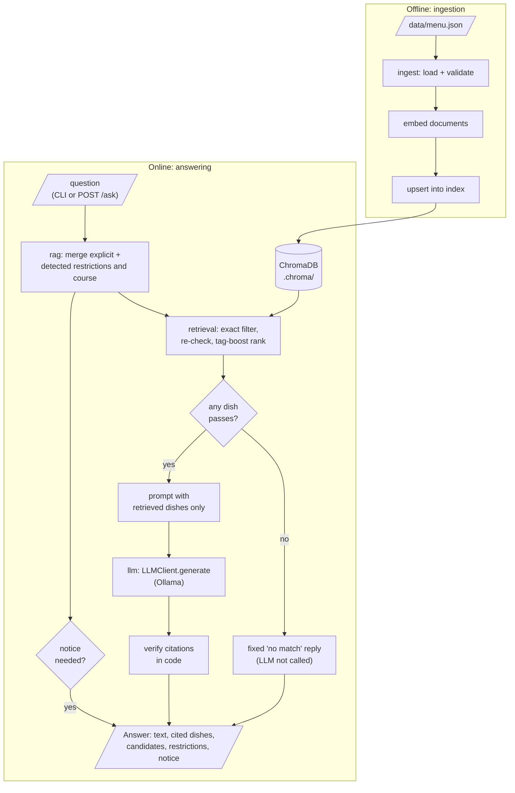

# Architecture

How menu-assistant turns a menu file into grounded dish suggestions. Design choices and
their trade-offs are recorded separately in [decisions.md](decisions.md).

## Overview

Everything in a rectangle except the `llm` step is deterministic code covered by unit
tests.

Two rules shape the whole design:

1. **Code decides, the LLM only writes.** Everything safety-relevant (which dishes are
   allowed, which are cited, whether a notice is shown) is computed in code and covered by
   unit tests. The LLM only phrases a reply from dishes it was given.
2. **Dependencies point inward.** `models.py` is shared by everything; `rag` depends on
   the `LLMClient` protocol and the retriever, never on a concrete provider; `api` and the
   CLIs are thin adapters that build objects from `Settings`.

## Packages

| Package      | Responsibility                                                         | Key types |
| ------------ | ---------------------------------------------------------------------- | --------- |
| `models.py`  | Menu domain: closed vocabularies for allergens, flags, courses; validation of flag/allergen contradictions | `Dish`, `Menu`, `Allergen`, `DietaryFlag`, `Course` |
| `config.py`  | Settings from environment / `.env`                                     | `Settings` |
| `ingest/`    | Load and validate a menu file, turn dishes into documents and metadata, upsert into the index | `load_menu`, `index_menu` |
| `retrieval/` | Embeddings, vector store access, deterministic filters, tag-boost ranking | `Embedder`, `MenuRetriever`, `SearchRequest`, `RetrievedDish` |
| `llm/`       | Provider-agnostic chat interface and the Ollama implementation         | `LLMClient`, `OllamaClient`, `LLMError` |
| `rag/`       | Restriction detection, prompt building, answer generation and verification | `AnswerService`, `Answer`, `Restrictions` |
| `api/`       | FastAPI app: request/response schemas, `/health`, `/ask`               | `create_app`, `AskRequest`, `AskResponse` |
| `eval/`      | Labeled datasets and metrics for retrieval and answer quality          | `evaluate`, `evaluate_answers`, `check_answer` |

## Ingestion (offline)

`python -m menu_assistant.ingest data/menu.json`

1. **Load and validate** (`ingest/loader.py`). The JSON is parsed into `Menu`. Unknown
   fields, unknown allergens, duplicate ids and contradictions (`vegan` + `eggs`) fail
   loudly here, so a typo can never weaken a filter later.
2. **Build documents** (`ingest/documents.py`). One document per dish with name, course,
   description, ingredients, preparation, tags and flags. Allergens are left out of the
   embedded text on purpose: embeddings ignore negation, so "no peanuts" would match
   peanut dishes.
3. **Build metadata.** Every allergen and flag becomes an explicit boolean key
   (`allergen_peanuts: false`, `diet_vegan: true`), plus the course and the full dish as
   JSON.
4. **Index** (`ingest/indexer.py`). Dishes are embedded with the `passage: ` prefix and
   upserted by id; dishes no longer in the menu are removed. The collection records an
   *index signature* (embedding model and prefixes). If it differs from the current
   settings, ingestion rebuilds the collection.

## Answering a question (online)

Entry points: `python -m menu_assistant.rag "<question>"` and `POST /ask`. Both call
`AnswerService.answer(question, explicit_restrictions)`.

### 1. Restrictions (`rag/restrictions.py`)

Restrictions come from two sources and are merged:

- **Explicit:** `--exclude` / `--diet` on the CLI, `exclude_allergens` / `require_flags`
  in the API. This is the reliable path for a UI.
- **Detected:** deterministic patterns over the normalized question in English,
  Portuguese and Spanish ("allergic to peanuts", "sem glúten", "soy vegano"). An allergen
  word only counts next to a cue word in the same clause, so "I love peanuts" does not
  exclude peanut dishes.

The result is a `Restrictions` value: allergens to exclude and flags to require.

The requested **course** is decided the same way (`rag/course.py`): an explicit
`--course` / `course`, otherwise explicit course words in the question ("dessert",
"sobremesa", "postre", "main course"). Several courses or a negation ("no dessert") mean
no course filter. The course is kept apart from `Restrictions` because it is a
preference, not a safety rule: it filters retrieval but does not trigger the notice.

### 2. Retrieval (`retrieval/search.py`)

`MenuRetriever.search(SearchRequest)`:

1. Embed the query with the `query: ` prefix.
2. Query ChromaDB with an exact `where` filter built from the restrictions and course
   (`build_where`), so only allowed dishes are ever candidates. A pool of 20 is fetched.
3. Re-check every candidate against the full dish data (`satisfies`). A stale index entry
   that disagrees is dropped and logged; it can never reach the LLM.
4. Re-rank: score = cosine similarity + `0.05` per dish tag named in the query.
5. Return the top `k` as `RetrievedDish` (dish, similarity, matched tags, score).

Before any search, the retriever factory checks that the index exists and that its
signature matches the settings (`IndexNotReadyError` / `IndexMismatchError`).

### 3. Generation (`rag/prompt.py`, `llm/`)

- If no dish passed the filters, a fixed `NO_MATCH_TEXT` is returned and the LLM is
  **not** called.
- Otherwise the user message contains the question, the applied restrictions and the
  retrieved dishes with every fact the model may use. The system prompt tells the model to
  use only those dishes, say when something is not on the menu, and cite as `[dish-id]`.
- The prompt goes through `LLMClient.generate(system, messages)`. The only provider is
  `OllamaClient`, which calls a local Ollama server's `/api/chat` over `httpx`. Failures
  become `LLMError` with a message saying how to fix them.

### 4. Verification (`rag/answer.py`)

- `verify_citations` keeps `[id]` citations of retrieved dishes, rewrites `[Dish Name]`
  to `[id]`, and removes id-like citations of dishes that were not retrieved.
- The staff-confirmation notice is attached in code whenever restrictions were applied or
  the question mentions allergens or diets. It never depends on the LLM's wording.

The returned `Answer` carries the text, cited dishes, all candidates, the restrictions
actually enforced, and the notice, so every reply can be audited.

## HTTP API (`api/`)

- `create_app(service_factory)` builds the `AnswerService` once in the FastAPI lifespan
  (loading the embedding model takes seconds) and stores it on `app.state`.
- If the index is missing or mismatched, the app still starts: `/health` returns
  `degraded` with the fix, and `/ask` returns `503`. An unreachable LLM also maps to `503`.
- `/ask` is a plain `def`, so FastAPI runs the blocking embedding and LLM calls in its
  thread pool instead of on the event loop.
- Tests pass a factory that returns a service with a fake embedder and a scripted LLM.

## Evaluation (`eval/`)

- **Retrieval** (`python -m menu_assistant.eval`): hand-labeled queries
  (`data/eval/retrieval_queries.json`) scored with recall@k, MRR and a filter-violation
  count that must stay at zero.
- **Answers** (`python -m menu_assistant.eval.answers`): labeled questions run through the
  real `AnswerService` and LLM, then scored with deterministic checks (invented citations,
  dishes named without being retrieved, relevance, notice, "not on the menu"). A
  `RecordingLLM` wrapper keeps the raw reply so invented ids are counted before clean-up.

See [evaluation.md](evaluation.md).

## Testing strategy

- Unit tests mirror `src/`. The embedder is replaced by a deterministic hash-based fake,
  ChromaDB runs on a temporary directory, and the LLM is a scripted fake or an `httpx`
  mock transport. No test touches the network or downloads a model.
- Safety rules (filters, citation verification, notice) are tested directly, because
  they are enforced in code.
- CI runs ruff, `ruff format --check`, strict mypy on `src` and `tests`, and pytest on
  every push.

## Extending

- **Another LLM provider:** implement `LLMClient.generate` in a new module under `llm/`,
  add its name to `Settings.llm_provider`, and add a branch in
  `llm/factory.py`. Nothing outside `llm/` changes.
- **Another menu:** write a JSON file that validates against `Menu` and run ingestion.
- **Another embedding model:** set `MENU_ASSISTANT_EMBEDDING_MODEL` (and its prefixes),
  re-run ingestion (the signature check forces it), and re-run the evaluation.
